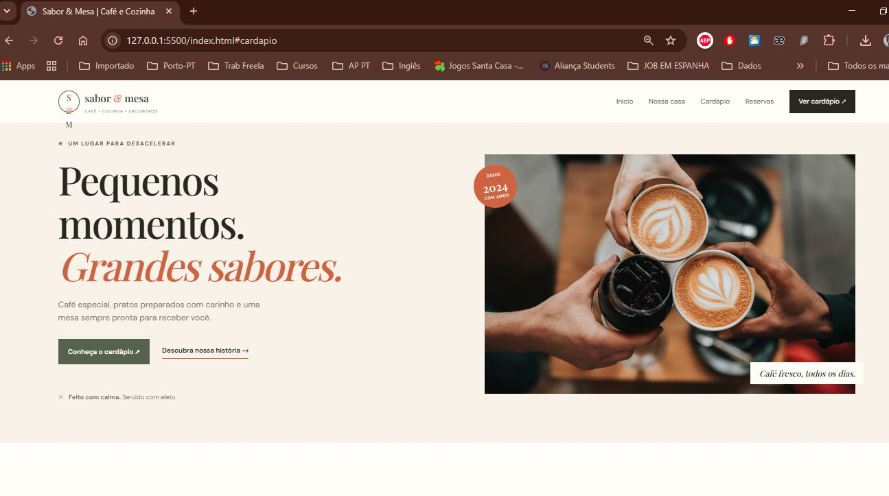

# Sabor & Mesa — Café e Cozinha

Projeto demonstrativo de site para restaurante/café fictício, desenvolvido para portfólio freelance.

## Prévia do projeto

## Funcionalidades
- Página inicial e apresentação do estabelecimento
- Cardápio digital com filtros por categoria
- Carrinho demonstrativo com cálculo de total
- Formulário de reserva demonstrativo
- Layout responsivo para computador e celular

## Tecnologias
HTML5, CSS3, JavaScript (vanilla), Git e GitHub Pages.

## Executar localmente
Abra `index.html` no navegador ou use a extensão Live Server no VS Code.

## Publicar no GitHub Pages
No repositório, acesse Settings → Pages. Escolha Deploy from a branch, branch `main` e pasta `/ (root)`, depois salve.

## Observações
Projeto fictício de portfólio. Nome, endereço, telefone, horário, cardápio e preços são ilustrativos. Carrinho e formulário não processam pedidos ou reservas reais. Fotografias e fontes externas precisam de conexão à internet.
